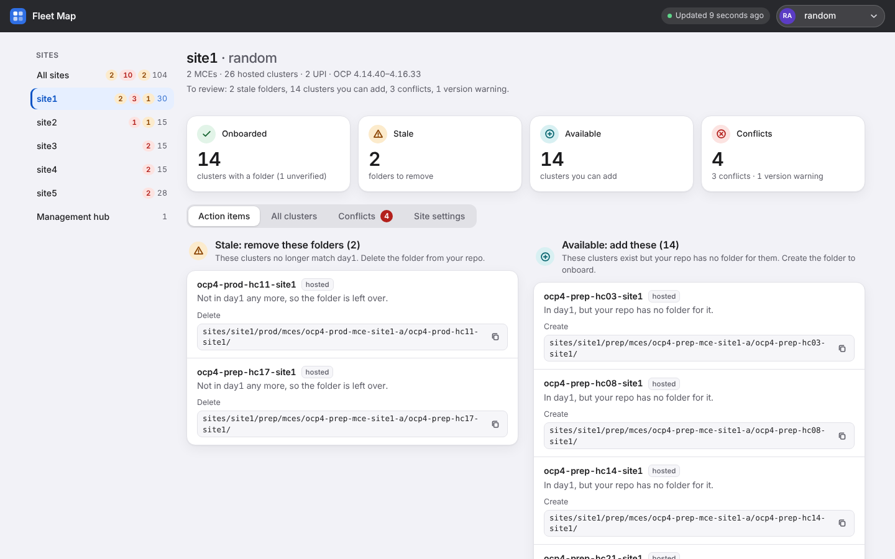
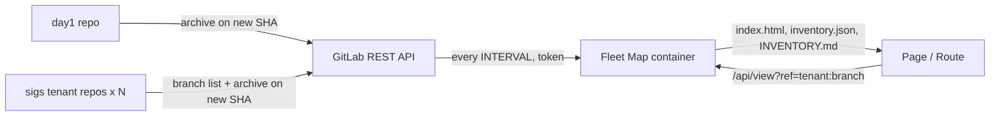

# Fleet Map

Fleet Map is a map of what's in day1 and what's in day2 sigs, and the gaps between them. It reads the day1 GitLab repo and every day2 tenant ("sigs") repo, then renders a cluster x tenant matrix. One container serves the page. It talks to the GitLab REST API only (no git).





## Quick start (OpenShift)

1. Create a token. Use a group access token on the common parent group (needs Owner), or a bot account's personal access token. Set role **Reporter**, scopes **`read_api` + `read_repository`**, and an expiry. The tool warns 14 days before it.
2. Create the Secret.
   ```sh
   oc create secret generic gitops-fleet-map-token --from-literal=token=glpat-REPLACE-ME
   ```
3. Edit `SIGS_URL` and `DAY1_URL` in `deploy/openshift.yaml`. Copy both from the browser. `SIGS_URL` is the sigs group. `DAY1_URL` is the day1 project; without it, stale detection is off. Set `image` too.
4. Apply the manifest.
   ```sh
   oc apply -f deploy/openshift.yaml
   ```
5. Open the Route. `oc logs deploy/gitops-fleet-map` prints the token's scopes and expiry, and one config line.

## What the page shows

| Item | Meaning |
|---|---|
| onboarded | The tenant repo has a folder for the cluster. Marked "via day1" when day1 expects it. |
| missing | Day1 expects the tenant, but there is no folder (the copy Job may have failed). Only shown when day1 registers clusters. |
| stale | A folder exists for a cluster that is no longer in day1. Delete it. |
| available | The cluster exists, the tenant has no folder, and the tenant could add one. Shows the path to create. |
| not in day2 | A day1 MCE or hosted cluster that no tenant repo has a folder for. Needs day1. |
| UPI | Flagged unverified. |
| conflicts, skew | Same chart with a different repo + revision across tenants, or a version mismatch. |
| provenance | Per chart: deploy-config and values layers in real priority order, the effective merge (value, set by, overrode), effective version and its source, and warnings. |
| branches | The **Branches** button picks a branch per tenant. The link holds the view: `#refs=a:dev,c:release&tenant=a&site=site1&tab=actions`. |
| upgrade | A cluster whose nodepool `workertag`s differ from its `mastertag` is shown as upgrade in progress. |

Rules for day1 and provenance:
- Env comes from the 2nd name token only if it is `prod|prep|test`. Otherwise the env-mismatch check is skipped.
- Layers merge like Helm: maps deep-merge, lists and scalars are replaced, the later layer wins, missing files are skipped. Order mirrors `operators.yaml` and `deployApp.yaml`; see `stacks()` in `fleetmap.py`.
- Hosted-cluster files may be `.yaml` or `.yml`. Day2 reads only `.yaml`, so a `.yml` cluster gets a warning.

## How freshness works

1. Every `INTERVAL`, the tool lists the group's projects and each tenant's branches (name + commit SHA). It also checks day1's branch.
2. A branch with the same SHA as the cache downloads nothing. The log says `no changes`.
3. A new SHA downloads that project's `repository/archive.tar.gz?sha=`. The archive is unpacked safely and swapped into the cache.
4. The page is regenerated only when a default-branch SHA changed, a project was added or removed, a tenant gained or lost a branch, or on the first run.
5. Non-default branches download only when you view them, and only for a never-seen commit. Trees are cached by SHA under `CACHE_DIR/trees/`.
6. Any error keeps the last good output.

> **Warning: GitLab rate-limits archive downloads** (low by default, per user). On HTTP 429 the tool honors `Retry-After`, pauses downloads, keeps old data and retries next cycle. Downloads are spaced 1 s apart. The first run of a big fleet can take a few cycles, and no page is produced until every project is fetched once. Raising the limit is an admin setting.

Before the first success, `/healthz` is ok and `/` is a 503 "No data yet". `GET /api/view` returns 400 for an unknown tenant or branch, and 503 with `Retry-After` on a 429.

## Settings

| Variable | Meaning |
|---|---|
| `SIGS_URL` | **Required.** Web URL of the sigs group. A trailing `/` or `/-/tree/main` is fine. A GitLab under a sub-path is detected via `/api/v4/version`. |
| `DAY1_URL` | Web URL of the day1 project, same GitLab. Unset = no day1 (banner shown). |
| `GITLAB_TOKEN` / `GITLAB_TOKEN_FILE` | The token, or a mounted Secret file (the file wins). Never logged. |
| `GITLAB_CA_FILE` | PEM trusted in addition to the system CAs. |
| `GITLAB_INSECURE=true` | Skip TLS verification. Avoid. |
| `INTERVAL` | Seconds between checks. Default 60. |
| `GIT_REF` | Branch name to read. Default: each project's default branch. |
| `CACHE_DIR` | Default `/tmp/fleet-cache`. |
| `MAX_CACHED_TREES` | Non-default trees kept on disk, least recently used first. Default 30. |
| `PREFETCH_REFS` | e.g. `a:dev,b:release`. Downloaded and rendered each cycle so the first click is instant. |
| `HIDE_VALUES=true` | Keys and origins only, no values (also `--hide-values`). |

Old `GITLAB_URL` + `SIGS_GROUP` (+ `DAY1_PROJECT`) still work. A bad config (no token, malformed URL) exits with code 2. Other startup errors are one line, and `serve` retries each interval.

## Build the image

| File | Base | Notes |
|---|---|---|
| `Dockerfile` (default) | `registry.access.redhat.com/ubi9/ubi-minimal:9.5` | Python 3.12 + PyYAML 6.0.2, pip removed. |
| `Dockerfile.alpine` | `python:3.12-alpine` | PyYAML, pip removed. |
| `build-ubuntu.sh` | Ubuntu noble via debootstrap | Fallback where only archive.ubuntu.com is reachable. Needs root, debootstrap, docker. |

1. Build with mirrors (works in disconnected environments).
   ```sh
   docker build -t registry.example/gitops-fleet-map:1.3.0 \
     --build-arg BASE=registry.example/ubi9/ubi-minimal:9.5 \
     --build-arg PIP_INDEX_URL=https://mirror.example/api/pypi/pypi/simple .
   ```
2. Or build the Alpine variant, or the Ubuntu fallback.
   ```sh
   docker build -f Dockerfile.alpine -t registry.example/gitops-fleet-map:1.3.0 .
   sh build-ubuntu.sh          # tags gitops-fleet-map:1.3.0
   ```
3. Load a saved tarball (check the checksum first), then push.
   ```sh
   sha256sum -c gitops-fleet-map-1.3.0.image.tar.gz.sha256
   gunzip -c gitops-fleet-map-1.3.0.image.tar.gz | docker load      # or: podman load -i ...
   docker tag gitops-fleet-map:1.3.0 registry.example/gitops-fleet-map:1.3.0
   docker push registry.example/gitops-fleet-map:1.3.0
   ```

No image contains git or curl. All run as UID 1001 (or any UID in group 0), `HOME=/tmp`, with writable `/data` and `/tmp`. `.gitlab-ci.yml` builds the image with kaniko on tags (unverified, see its header).

## Development

1. Install dependencies (Python 3.12).
   ```sh
   pip install PyYAML
   ```
2. Generate from local folders.
   ```sh
   python fleetmap.py generate --out out --sigs-dir tests/fixtures/sigs --day1-dir tests/fixtures/day1
   ```
3. Generate once from GitLab, or serve with refresh.
   ```sh
   SIGS_URL=... GITLAB_TOKEN=... python fleetmap.py generate --out out
   python fleetmap.py serve --out /tmp/out --port 8080
   ```
4. Run the tests. Browser tests need Playwright with chromium; they are skipped when it is missing or `SKIP_UI=1`.
   ```sh
   bash tests/run.sh
   SKIP_UI=1 bash tests/run.sh
   ```
5. Run the e2e (real image on k3s against a fake GitLab). See `e2e/README.md`.
   ```sh
   sh e2e/up.sh && sh e2e/check.sh
   ```

Output file names (`index.html`, `inventory.json`, `INVENTORY.md`) are an API. Do not rename them.

## Security notes

- Use a read-only token: Reporter, `read_api` + `read_repository`. Set an expiry.
- The page is shared across tenants. Values whose key path matches `pass|secret|token|key|cert|cred|auth` (case-insensitive) show as "••• (hidden)" and never reach the page.
- Set `HIDE_VALUES=true` to emit no values at all (effective values, repo, path, namespace, revision). Keys, layer origins, sync mode and warnings stay.
- Archives are unpacked safely. Absolute paths, `..`, escaping links and device files are rejected. A bad archive is logged and skipped until that project has a new commit.
- `/api/view` accepts only a tenant and branch from the last cycle's lists. Input never reaches a URL or path except an exact listed branch name, URL-encoded. The archive request uses the commit SHA only. Rejected requests never reach GitLab.
- The container runs non-root with a read-only root, all capabilities dropped, and no privilege escalation.

Internal. All rights reserved.
